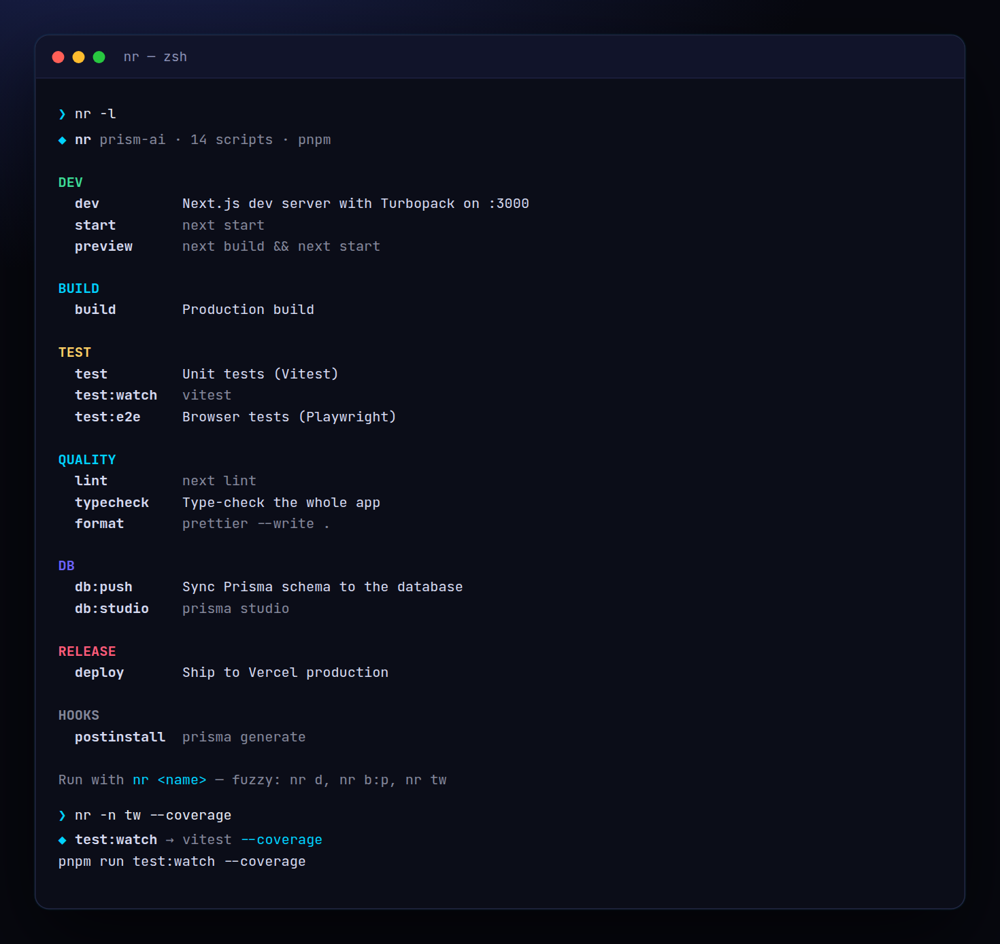

<!-- ═════════════ HEADER ═════════════ -->
<p align="center">
  
</p>

<p align="center">
  
</p>

<p align="center">
  <a href="https://github.com/krishyaa06/prism-npm-scripts/actions/workflows/ci.yml"></a>
  
  
  <a href="LICENSE"></a>
</p>

<p align="center">
  
</p>


## ⚡ Overview

**Prism npm Scripts** (`nr`) is the fastest way to run what's in `package.json`. Run `nr` for an interactive picker (type to filter, arrows, enter), `nr -l` for a grouped overview with descriptions, or `nr <query>` to fuzzy-run a script: `nr d` → `dev`, `nr b:p` → `build:prod`, `nr tw` → `test:watch`. It finds the nearest `package.json`, picks the right package manager from `packageManager` or the lockfile (walking up for monorepos) and passes extra arguments straight through.

## ✨ Features

- **Interactive picker**: type to filter, ↑↓ to move, enter to run
- **Fuzzy matching**: exact → prefix → segments (`t:e`) → initials (`tw`) → subsequence; ambiguity is reported, not guessed
- **Grouped list**: dev, build, test, quality, db, release, hooks — with descriptions from `scripts-info` or `//name` keys
- **Package manager detection**: `packageManager` field, bun / pnpm / yarn / npm lockfiles, walks up for monorepos
- Args passthrough (`nr test --watch`), `--dry-run`, `--json`, exit codes and timing forwarded
- Works from any sub-folder; zero dependencies

## 🚀 Quick Start

```bash
# run without installing
npx github:krishyaa06/prism-npm-scripts -l

# or install globally
npm install -g github:krishyaa06/prism-npm-scripts
nr 
```

Requires Node.js 18.17+. No dependencies.

## 🛠️ Usage

```text
nr                  pick a script (arrow keys / type to filter)
nr <query> [args]   fuzzy-run: nr d → dev, nr b:p → build:prod, nr tw → test:watch
nr -l, --list       list scripts grouped, with descriptions
nr --json           scripts as JSON

  -p, --pm <pm>       force npm | pnpm | yarn | bun (default: from lockfile)
  -n, --dry-run       print the command instead of running it
  -C, --cwd <dir>     start from another folder
```

### Describe your scripts

```json
{
  "scripts": { "dev": "next dev --turbo", "deploy": "vercel --prod" },
  "scripts-info": {
    "dev": "Next.js dev server with Turbopack on :3000",
    "deploy": "Ship to Vercel production"
  }
}
```

## 📁 Project Structure

```text
prism-npm-scripts/
├── assets/
│   ├── logo.png
│   └── logo.svg
├── bin/
│   └── nr.js   # CLI entry
├── examples/
│   └── app/   # demo package.json
│       └── package.json
├── src/
│   ├── index.js   # package.json, PM detection, fuzzy match
│   └── ui.js   # colours, tables
├── test/
│   └── nr.test.js
├── .gitignore
├── LICENSE
└── package.json
```

## 🧪 Tests

```bash
npm test
```

Tests use the built-in `node:test` runner, so there is nothing to install. CI runs them on Node 20 and 22.

## 🤝 Contributing

1. Fork the repo and create a branch: `git checkout -b feature/my-idea`
2. Make your change and add a test in `test/`
3. Run `npm test` and open a Pull Request

## 🔷 Part of Prism Protocol

Prism npm Scripts is one of the open-source tools built by [Prism Protocol](https://dc.gg/prismprotocol), a tech community where young builders learn, ship and compete together.

## 👤 Author

<table>
  <tr>
    <td align="center">
      <a href="https://github.com/krishyaa06"><br><b>Soumya Bhandare</b></a><br>
      <sub>Founder @ Prism Protocol</sub>
    </td>
    <td>
      <a href="https://dc.gg/prismprotocol"></a><br>
      <a href="https://instagram.com/prism_protocol_"></a><br>
      <a href="https://x.com/krishyaa06"></a>
    </td>
  </tr>
</table>

## 📄 License

Released under the [MIT License](LICENSE).

<p align="center">
  <b>If you like this project, consider giving it a ⭐</b><br>
  <sub>"Build. Create. Compete." · Made with ⚡ by Prism Protocol</sub>
</p>


